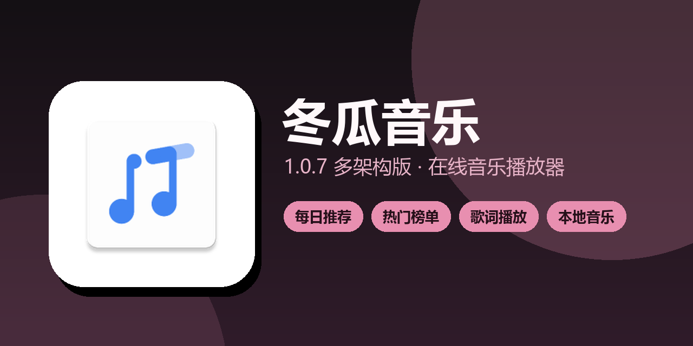
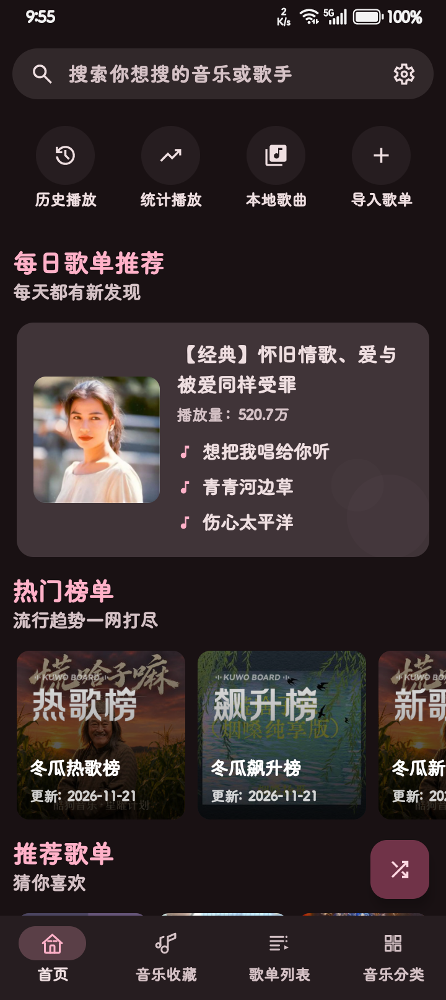
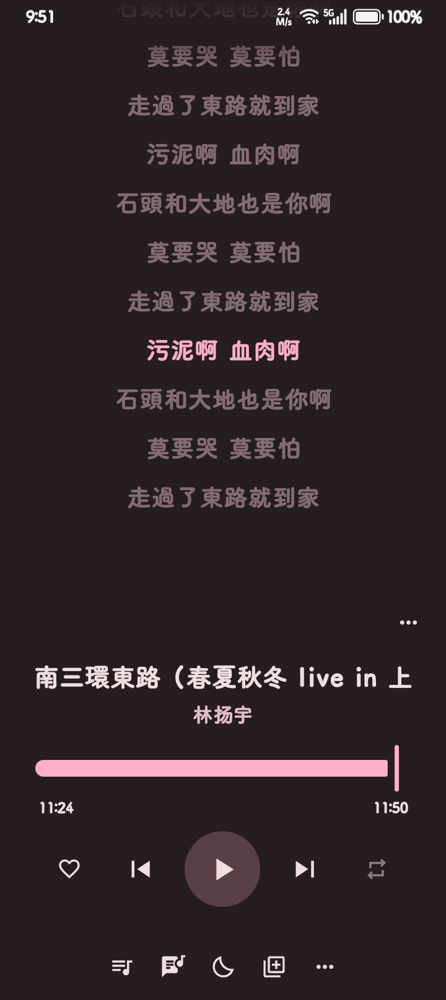
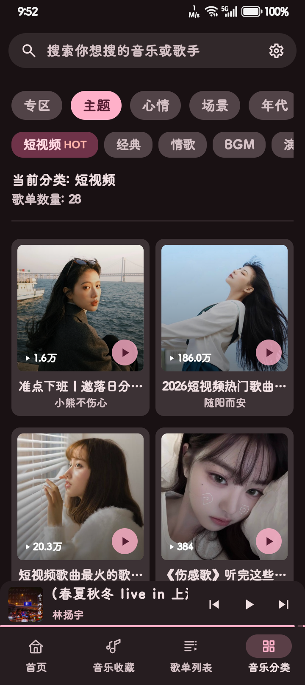
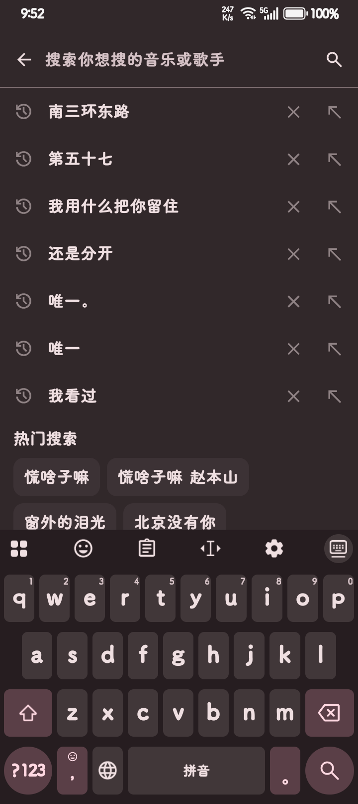
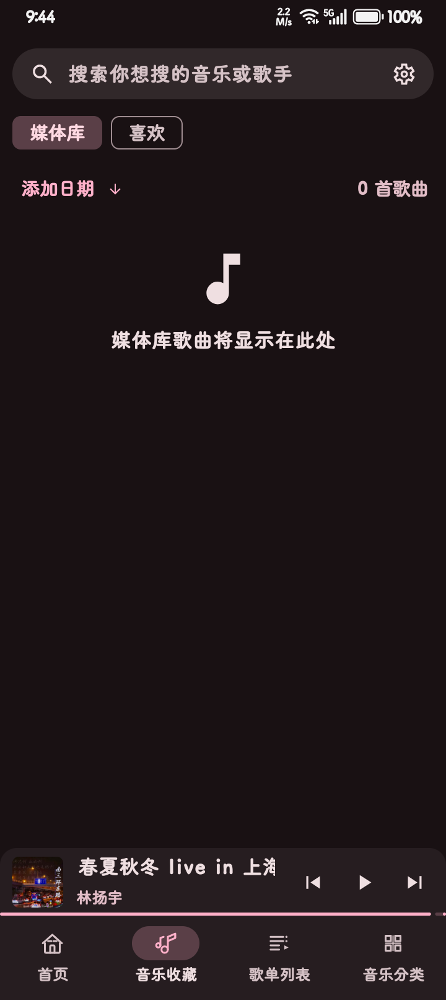
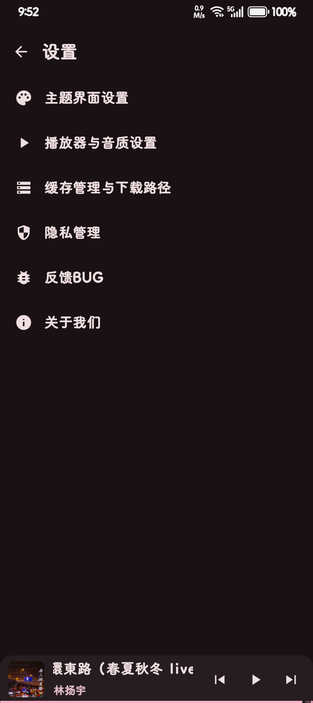

# 冬瓜音乐 1.0.7

**每日推荐 · 热门榜单 · 歌词播放 · 本地音乐 · 多 CPU 架构安装包**

  

---

> **二创声明**
>
> 本软件为二创版本。  
> 二创作者：**不许人间见白头**  
> 基于原版「冬瓜音乐」修改，仅供学习交流使用，请勿用于商业用途。  
> 如有侵权，请联系删除。  
> 项目地址：<https://github.com/BaiX-sudo/tonguamsic>

---

## 📖 软件简介

**冬瓜音乐**是一款面向 Android 平台的在线音乐播放器与本地音乐管理工具。它把「每日推荐」「热门榜单」「分类歌单」「搜索」「歌词播放」「本地音乐」「自建歌单」等功能集中在一个应用里，界面采用深色主题与 Material 3 设计，适合日常听歌、发现新歌和整理本地音乐库。

当前版本为 **1.0.7**，应用包名为 `com.xifeng.music`，最低支持 Android 7.0。本仓库提供按 CPU 架构拆分后的多个安装包，方便不同设备选择更小的包体，减少不必要的 native 库占用。

> 适用系统：Android 7.0 及以上  
> 当前版本：1.0.7（versionCode 26）  
> 软件语言：简体中文  
> 主题：深色音乐播放器风格

---

## 🖼️ 界面预览

| 首页 | 正在播放 | 音乐分类 |
| :---: | :---: | :---: |
|  |  |  |

| 搜索 | 音乐收藏 | 设置 |
| :---: | :---: | :---: |
|  |  |  |

> 截图仅用于展示界面与功能，图中歌曲、封面、榜单与平台标识版权归各自权利人所有。

---

## ✨ 功能特性

### 1. 首页与每日推荐

- 顶部搜索栏，支持按歌曲、歌手搜索
- 历史播放、统计播放、本地歌曲、导入歌单快捷入口
- 每日歌单推荐，每天更新不同主题
- 热门榜单：冬瓜热歌榜、冬瓜飙升榜、冬瓜新歌榜
- 推荐歌单与猜你喜欢
- 底部迷你播放器，随时控制播放

### 2. 在线音乐播放

- 在线搜索歌曲与歌手
- 播放热门榜单、分类歌单与推荐歌单
- 支持播放 / 暂停、上一首 / 下一首
- 支持收藏、循环模式、定时关闭
- 支持添加到自建歌单
- 支持后台播放与通知栏媒体控制（以前台服务运行）

### 3. 歌词与播放页

- 滚动歌词显示
- 当前歌词高亮
- 播放进度与总时长
- 收藏、循环、定时关闭、添加到歌单、更多操作
- 专辑封面、歌曲名与歌手信息
- 播放页可直接进入歌词与播放控制

### 4. 音乐收藏

- **媒体库**：展示本地媒体库中的歌曲
- **喜欢**：展示已收藏的歌曲
- 支持按添加日期排序
- 空状态提示清晰，便于管理本地音乐

### 5. 歌单列表

- 展示用户自建歌单
- 支持新建歌单
- 按添加日期排序
- 歌单内可继续添加歌曲
- 与首页推荐歌单、分类歌单统一管理

### 6. 音乐分类

- 分类维度：专区、主题、心情、场景、年代
- 标签筛选：短视频 HOT、经典、情歌、BGM 等
- 歌单卡片展示封面、播放量、标题与作者
- 适合按场景和心情发现新歌

### 7. 搜索

- 搜索历史记录
- 热门搜索推荐
- 支持歌曲名、歌手名搜索
- 搜索结果可直接播放或加入歌单
- 支持清空单条历史与查看全部

### 8. 本地音乐与导入

- 扫描本地媒体库
- 播放本地音频文件
- 导入外部歌单
- 本地歌曲与在线歌曲统一播放
- 支持缓存管理与下载路径设置

### 9. 主题与设置

- 主题界面设置
- 播放器与音质设置
- 缓存管理与下载路径
- 隐私管理
- 反馈 BUG
- 关于我们

### 10. 多架构安装包

- 按 CPU 架构拆分：`arm64-v8a`、`armeabi-v7a`、`x86_64`
- 提供 `universal` 通用包
- 所有变体使用同一签名，方便覆盖安装
- 拆分后单个包体更小，减少存储占用

---

## 📦 多架构安装包

| 架构 | 适用设备 | 大小 | 下载 | ADB 可用性检查 |
| --- | --- | ---: | --- | --- |
| **universal** | 不确定设备架构，或希望一个包通用 | 11.5 MiB | [下载](apk/DongguaMusic-1.0.7-universal.apk) | ✅ 安装/启动正常，`primaryCpuAbi=arm64-v8a` |
| **arm64-v8a** | 大多数现代 Android 手机、平板 | 10.7 MiB | [下载](apk/DongguaMusic-1.0.7-arm64-v8a.apk) | ✅ 安装/启动正常，`primaryCpuAbi=arm64-v8a` |
| **armeabi-v7a** | 32 位 ARM 老设备 | 10.6 MiB | [下载](apk/DongguaMusic-1.0.7-armeabi-v7a.apk) | ✅ 安装/启动正常，`primaryCpuAbi=armeabi-v7a`；Android 14 可能提示兼容性，确认后可继续 |
| **x86_64** | x86_64 模拟器、部分 x86 平板 | 10.8 MiB | [下载](apk/DongguaMusic-1.0.7-x86_64.apk) | ⚠️ ARM 测试机无法安装（`INSTALL_FAILED_NO_MATCHING_ABIS`）；已通过签名、对齐与 ABI 结构校验，需 x86_64 设备/模拟器运行 |

> 校验文件：[SHA256SUMS.txt](apk/SHA256SUMS.txt)  
> 推荐优先选择 `arm64-v8a`；不确定时选择 `universal`。  
> 所有包使用同一签名（`CN=Donggua Music`），可覆盖安装同一版本的不同架构包；与原版或其他签名版本不兼容，需先卸载。

### 如何选择

- **2018 年之后的绝大多数手机**：`arm64-v8a`
- **较老的 32 位手机/电视盒子**：`armeabi-v7a`
- **x86_64 模拟器 / x86 平板**：`x86_64`
- **不想判断架构**：`universal`

---

## 🧪 上传前可用性检查

本次发布前已在真实设备上通过 ADB 完成安装与启动检查：

- 测试设备：**JDY-AN00**，Android 14
- 设备支持架构：`arm64-v8a, armeabi-v7a, armeabi`
- 测试方式：卸载旧版本 → 安装对应架构 APK → 启动 `com.xifeng.music/.MainActivity` → 截图与进程检查

| 安装包 | 安装 | 启动 | 实际使用架构 | 结果 |
| --- | :---: | :---: | --- | --- |
| universal | ✅ | ✅ | `arm64-v8a` | 正常进入首页 |
| arm64-v8a | ✅ | ✅ | `arm64-v8a` | 正常进入首页 |
| armeabi-v7a | ✅ | ✅ | `armeabi-v7a` | 正常进入首页；Android 14 对 32 位应用有兼容性提示，确认后可继续 |
| x86_64 | ⚠️ | — | — | ARM 设备返回 `INSTALL_FAILED_NO_MATCHING_ABIS`，符合预期；需 x86_64 环境运行 |

所有安装包同时通过：

- `apksigner verify` 签名校验
- `zipalign -c -p 4` 对齐校验
- `aapt2 dump badging` 架构与包名校验
- `AndroidManifest.xml` 包名/版本号校验

> x86_64 包未在 ARM 手机上运行是架构差异导致的正常现象，不代表安装包损坏。x86_64 设备/模拟器可直接安装测试。

---

## 📥 安装指南

### 环境要求

- Android 7.0（API 24）及以上
- 建议预留 100 MB 以上存储空间
- 在线播放需要网络连接
- 保存/缓存歌曲需要存储权限

### 安装步骤

1. 根据设备架构下载对应 APK，或直接下载 `universal`。
2. 在文件管理器中点击 APK。
3. 如系统提示「禁止安装未知应用」，请为当前文件管理器开启「允许安装未知应用」。
4. 完成安装并打开应用。
5. 首次启动会显示二创声明，阅读后点击「确定」即可进入首页。

> 如果已安装原版「冬瓜音乐」或其他签名版本，请先卸载旧版本，否则会提示签名冲突。卸载前请自行备份歌单与本地数据。

### 权限说明

| 权限 | 用途 |
| --- | --- |
| 网络 / 网络状态 | 在线搜索、播放、加载榜单与封面 |
| 通知 | 后台播放控制与播放状态展示 |
| 前台服务 / 媒体播放 | 后台音乐播放 |
| 存储 / 音频读取 | 扫描本地音乐、缓存歌曲 |
| 安装未知应用 | 应用内更新（如使用） |
| 开机启动 / WakeLock | 恢复播放服务与保持播放稳定 |

---

## 🚀 使用指南

### 搜索与播放

1. 在首页顶部搜索框输入歌曲名或歌手名。
2. 在搜索结果中选择歌曲。
3. 进入播放页后可查看歌词、收藏、切换循环模式。
4. 使用底部迷你播放器快速暂停/继续。

### 每日推荐与热门榜单

1. 首页「每日歌单推荐」每天更新主题歌单。
2. 「热门榜单」提供热歌榜、飙升榜、新歌榜。
3. 点击歌单卡片进入详情，选择歌曲播放或收藏。

### 音乐分类

1. 底部进入「音乐分类」。
2. 选择专区、主题、心情、场景或年代。
3. 使用标签进一步筛选，例如「短视频 HOT」「经典」「情歌」「BGM」。
4. 点击歌单卡片查看详情与播放。

### 收藏与歌单

- **音乐收藏**：查看本地媒体库与喜欢的歌曲。
- **歌单列表**：查看、创建和管理自建歌单。
- 播放页点击收藏或「添加到歌单」即可整理音乐。

### 本地音乐

1. 首页点击「本地歌曲」。
2. 授予音频读取权限。
3. 扫描并播放本地音乐。
4. 可在设置中管理缓存与下载路径。

### 播放页操作

- 播放 / 暂停
- 上一首 / 下一首
- 收藏
- 循环模式
- 定时关闭
- 添加到歌单
- 更多操作

---

## 🧱 技术栈

| 模块 | 技术 |
| --- | --- |
| 开发语言 | Kotlin |
| UI | Jetpack Compose、Material 3 |
| 媒体播放 | AndroidX Media3 / ExoPlayer |
| 图片加载 | Coil |
| 数据存储 | DataStore |
| 异步 | Kotlin Coroutines |
| 架构 | 原生 Android，组件化页面与播放服务 |
| 原生库 | 音乐播放/处理相关 native 库（按 ABI 分包） |
| 最低系统 | Android 7.0（API 24） |
| 目标系统 | Android 15（API 35） |

### 包体说明

- 每个架构包只保留对应 ABI 的 `lib/<abi>/` 原生库。
- `universal` 同时包含 `arm64-v8a`、`armeabi-v7a`、`x86_64` 三套库。
- 拆分后包体从约 11.5 MiB 降至约 10.6–10.8 MiB。
- 所有包均重新对齐并签名，安装包结构完整。

---

## ❓ 常见问题

### 1. 我应该下载哪个架构？

大多数现代手机选择 `arm64-v8a`。不确定时选择 `universal`。老款 32 位设备选择 `armeabi-v7a`，x86_64 模拟器或平板选择 `x86_64`。

### 2. 为什么 armeabi-v7a 在 Android 14 上提示「不兼容」？

Android 14 对 32 位应用会显示兼容性提示。该提示不影响安装和基本使用，点击「确定」后可继续。若设备支持 64 位，建议改用 `arm64-v8a` 或 `universal`，体验更稳定。

### 3. 为什么 x86_64 包在手机上安装失败？

手机是 ARM 架构，无法运行 x86_64 原生库，系统会返回 `INSTALL_FAILED_NO_MATCHING_ABIS`。这是正常现象，请在 x86_64 模拟器或 x86 设备上安装。

### 4. 安装时提示签名冲突怎么办？

本仓库所有包使用统一的新签名。如果手机上安装的是原版或其他签名版本，请先卸载旧版本再安装。卸载前请备份歌单与本地数据。

### 5. 需要登录吗？

浏览、搜索和播放等核心功能无需登录。部分内容、音质或平台服务可能受第三方平台限制，以应用内实际表现为准。

### 6. 支持后台播放吗？

支持。应用使用前台服务与通知栏媒体控制，切换应用后仍可继续播放。

### 7. 歌词不显示或不同步怎么办？

歌词来自在线资源，可能受网络、歌曲版本或平台接口影响。可以尝试切换歌曲、检查网络或稍后重试。

### 8. 歌曲/封面/榜单来自哪里？

应用聚合展示第三方平台的公开内容与榜单信息。音乐、封面、歌词、榜单等版权归各平台与权利人所有，本仓库不存储、不托管这些内容。

### 9. 可以商用吗？

不可以。应用内公告明确说明：仅供学习交流使用，请勿用于商业用途。请同时遵守原项目与各内容平台的服务条款。

### 10. 有源码吗？

本仓库提供多架构 APK 分发与使用说明。应用包含第三方组件与加固/保护模块，源码不在本仓库中；原项目与二创作者信息见顶部声明。

---

## 🔐 隐私与权限

- 播放记录、收藏、歌单与设置默认保存在本地设备。
- 在线搜索、播放、榜单与封面加载需要访问网络及第三方平台。
- 本地音乐扫描需要音频/存储读取权限。
- 后台播放使用前台服务与通知权限。
- 本仓库不收集、不上传你的本地音乐文件。
- 第三方平台与 SDK 可能按照其隐私政策处理必要的设备与网络信息。

完整说明请阅读 [PRIVACY.md](PRIVACY.md)。

---

## ⚠️ 免责声明

1. 本软件为基于原版「冬瓜音乐」的二创版本，二创作者为「不许人间见白头」。
2. 本项目仅供学习、研究和技术交流使用，请勿用于任何商业用途。
3. 请仅播放、下载你有权访问的内容。不得使用本软件传播侵犯他人著作权、隐私权或其他合法权益的内容。
4. 应用内展示的歌曲、封面、歌词、榜单、平台名称与商标归其各自权利人所有。
5. 本项目与任何音乐平台均不存在隶属、合作或授权关系。
6. 因使用本软件产生的任何直接或间接损失，项目作者不承担责任。
7. 如果权利人认为本项目侵犯其权益，请通过 Issues 联系，我们会及时处理。

完整声明请阅读 [DISCLAIMER.md](DISCLAIMER.md)。

---

## 📄 许可证

本仓库沿用原项目的 **GNU General Public License v3.0**。

- 许可证全文：[LICENSE](LICENSE)
- 应用内公告同时要求：仅供学习交流，请勿用于商业用途。
- 音乐、封面、歌词、榜单等内容的版权不适用本许可证，归各自权利人所有。

---

## 🙏 致谢

- 原版「冬瓜音乐」
- 二创作者：**不许人间见白头**
- [Android](https://www.android.com/)
- [Jetpack Compose](https://developer.android.com/jetpack/compose)
- [Material 3](https://m3.material.io/)
- [AndroidX Media3](https://developer.android.com/media/media3)
- [Coil](https://coil-kt.github.io/coil/)
- 以及所有为 Android 开源生态做出贡献的开发者

---

**如果这个项目对你有帮助，欢迎点亮 Star ⭐**

Made with ❤️ for Music

